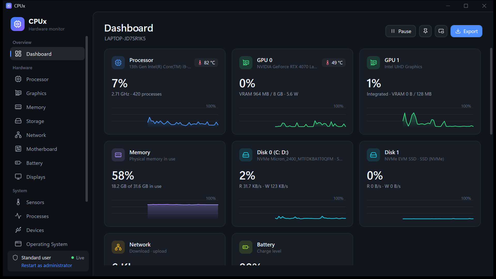

# CPUx

A modern hardware information and live system monitor for Windows 10 and 11, with fan control and a stability stress test.

- **See everything:** processor, every GPU, memory, every drive (including USB drives), network, motherboard, battery, displays, sensors, processes and devices.
- **Fan control:** set each fan's speed or leave it on automatic (ASUS laptops, supported desktop boards and GPUs).
- **Stress test:** processor, graphics, memory and storage, with error checking and safety stops.

[Source code on GitHub](https://github.com/KuldipGami/CPUx) · [Privacy policy](privacy/)
